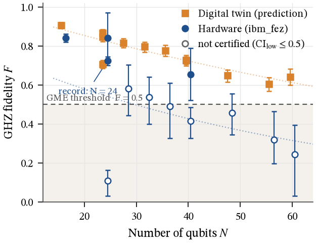
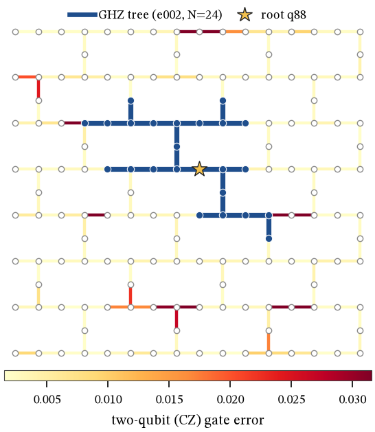

# Q-Scientist — an autonomous AI physicist on IBM quantum hardware

**Live:** https://q-scientist.vercel.app (replay of the real ibm_fez run) · **Paper:** [runs/20261107-220808-qpu/paper/paper.pdf](runs/20261107-220808-qpu/paper/paper.pdf)

Publish a static snapshot: `uv run python -m scripts.export_static && cd site && vercel deploy --prod`


An AI agent (Gemini) runs GHZ-entanglement experiments on its own — noisy simulator first,
then a real IBM Heron QPU — trying to **certify genuine multipartite entanglement
(fidelity lower confidence bound > 0.5) on as many qubits as possible**. It reasons out loud,
respects a hard QPU/LLM budget, and writes its own paper at the end.

## Results on real hardware (IBM `ibm_fez`, 156-qubit Heron)

| GHZ size · circuit | Twin prediction (frozen before the run) | Hardware fidelity [95% CI] | Genuinely entangled? |
|---|---|---|---|
| 16 · error-weighted tree | 0.906 | **0.841** [0.820, 0.862] | ✅ certified |
| **24 · error-weighted tree** | 0.866 | **0.723** [0.700, 0.746] | ✅ **certified (record)** |
| 24 · breadth-first tree (round 2) | 0.845 | 0.842 [0.720, 0.972] | ✅ certified (noisier) |
| 24 · linear CNOT chain | 0.705 | 0.107 [0.031, 0.163] | ❌ |
| 28 · tree (round 2) | 0.815 | 0.580 [0.444, 0.703] | ❌ |
| 32 · tree | 0.796 | 0.537 [0.400, 0.641] | ❌ |
| 36 · tree (round 2) | 0.776 | 0.489 [0.327, 0.609] | ❌ |
| 40 · tree (round 1) | 0.727 | 0.654 [0.520, 0.788] | ✅ by 0.02, then failed its re-run ↓ |
| 40 · same qubits, 2× shots (round 2 re-run) | 0.726 | 0.414 [0.326, 0.486] | ❌ |
| 48 / 56 / 60 · tree | 0.648 / 0.604 / 0.642 | 0.455 / 0.319 / 0.244 | ❌ |

**Findings:**
- **Record: 24 qubits** of genuine multipartite entanglement, F = 0.723 [0.700, 0.746]. A second 24-qubit run with a
  different tree also certified (overlapping qubits, 20 of 24 shared; wider interval).
- **The confirmation step caught a false positive.** Round 1 certified 40 qubits by 0.02. The validator had already
  forced a pre-registered re-run of the best result into round 2; on the same qubits with twice the shots it measured
  F = 0.414, so 40 qubits is not claimed (paper, site and log). Best-of-several selection biases records upward; this
  run shows it happening.
- **Circuit shape is the difference between entangled and not.** At 24 qubits a shallow tree (two-qubit depth 8)
  reached F = 0.723, a linear CNOT chain (depth 23) collapsed to 0.107. A tree that ignores error rates did as well,
  so the gain is depth, not error-weighting.
- **The digital twin overestimated every experiment** (mean +0.24, range +0.003 to +0.597), generally more at large N:
  correlated noise that per-gate calibration data doesn't capture.
- **Caveat:** certified values use readout mitigation, which amplifies noise at large N (some mitigated parities exceed
  ±1); no unmitigated check was run.

12 hardware experiments in two rounds; 322 s of QPU used out of 600 s free (self-imposed cap 480 s).




## Run
```bash
cp .env.example .env          # add GEMINI_API_KEY, IBM_QUANTUM_TOKEN, IBM_QUANTUM_INSTANCE
uv run python -m scripts.run_agent --mode sim            # free: simulator only
uv run python -m scripts.run_agent --mode qpu            # real hardware (budget-capped)
uv run python -m scripts.run_agent --mode sim --llm fake # no keys needed: scripted policy
uv run python -m scripts.run_sweep --mode qpu --ns 16,24,32   # no-AI fallback

# Queue-aware hardware run (what ran on ibm_fez, where the open queue holds ~20k jobs):
uv run python -m scripts.qpu_batch submit --backend ibm_fez           # Gemini designs a batch, digital twin predicts, all jobs submitted at once
uv run python -m scripts.qpu_batch collect runs/<run_id> --watch      # gather results as IBM finishes them
uv run python -m scripts.qpu_batch extend runs/<run_id>               # round 2: agent reads hardware results, confirms its record
uv run python -m scripts.check_keys                                   # which keys are set (never prints values)
uv run python -m scripts.write_paper runs/<run_id>        # paper.html + paper.pdf
uv run python -m scripts.serve_ui                         # mission control at http://localhost:8765
uv run python -m pytest -q                                # 65 tests
```

## How it works
- `qsci/core` — calibration → error-weighted GHZ tree layout → circuits → fidelity
  F = (P₀…₀ + P₁…₁)/2 + C/2 from populations + 2N+2 parity-oscillation circuits, bootstrap CIs,
  readout mitigation; one SamplerV2 job per hardware experiment. Fast Pauli-frame noisy simulator.
- `qsci/agent` — Gemini function-calling loop; hardware is gated on a certified simulation and a budget check;
  certification is recomputed from data so the model can't over-claim.
- `ui/` — mission-control replay of the whole night. `qsci/paper` — paper generated from the run log.

See `CONTRACTS.md` for data formats.
